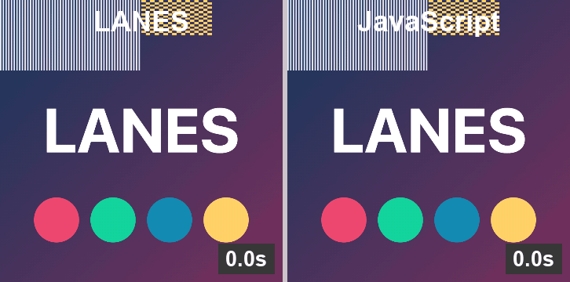

# LANES

A language and compiler built for the final assignment of *2650_COMP_2001_2*.




LANES is a statically typed programming language designed to make SIMD (Single Instruction, Multiple Data) programming easier. SIMD allows efficient processing of large volumes of data by applying an operation over multiple registers in a single CPU instruction. LANES compiles to WAT (and WASM), enabling performant computation in modern web browsers.

LANES does this with `ruleset` functions and `field` types. A field represents a fixed-length collection of integers, floats or booleans, such as `field<f32, 1024>`, and an operation on a field applies to every value in it. A ruleset is a function that works on fields, which the compiler turns into a SIMD loop processing 4 values per instruction. For example, this ruleset brightens every pixel of an image, keeping each value between 0 and 1:

```
ruleset brighten(pixels: field<f32, 1024>, amount: f32) -> field<f32, 1024> {
    return clamp(pixels + amount, 0.0, 1.0);
}
```

## Getting Started

The LANES compiler outputs WAT (WebAssembly Text) by default, and uses WAT2WASM to translate it into machine code. This dependency can be installed with:

```
make install // installs wat2wasm via brew / apt-get
```

The compiler can then be built, and the demo can be compiled. Once completed, open it in your browser to see LANES run. **Note: Compiling the demo requires Node installed to package the WASM into the html file**

```
make demo # builds compiler, then compiles demo. outputs 'demo/benchmarks.html'.
```

The compiler can also be built without compiling the demo:

```
make # outputs to 'build/'
```

The unit-test suite can be run with:

```
make test # run all tests & print results
```
All build artifacts can be removed with:
```
make clean # remove all build artifacts
```
## Running the compiler

Once built, the compiler is at `build/lanes`. It takes one LANES source file:

```
build/lanes <input file> [-t]
```

By default the compiler writes a `.wasm` file next to the input, with the same name (`program.lanes` becomes `program.wasm`). This step uses WAT2WASM, so it must be installed. The `-t` flag writes human readable WAT instead (`program.wat`), and does not need WAT2WASM.

If the program has errors, they are printed and no output is written.

For example, the following program prints 42, and has a ruleset that multiplies every value in a field by `k`:

```
ruleset scale(x: field<f32, 1024>, k: f32) -> field<f32, 1024> {
    return x * k;
}

function main() -> integer {
    print(42);
    return 0;
}
```

Every function and ruleset is exported from the `.wasm` file, along with its memory. `print` calls a function the host must provide, such as `print_i32` for integers. The module can be run with Node:

```
import { readFile } from "node:fs/promises";

const bytes = await readFile("program.wasm");
const { instance } = await WebAssembly.instantiate(bytes, {
    env: { print_i32: (value) => console.log(value) },
});
instance.exports.main(); // prints 42
```

## Markers
Markers: read [Markers.md](Markers.md) for further information.